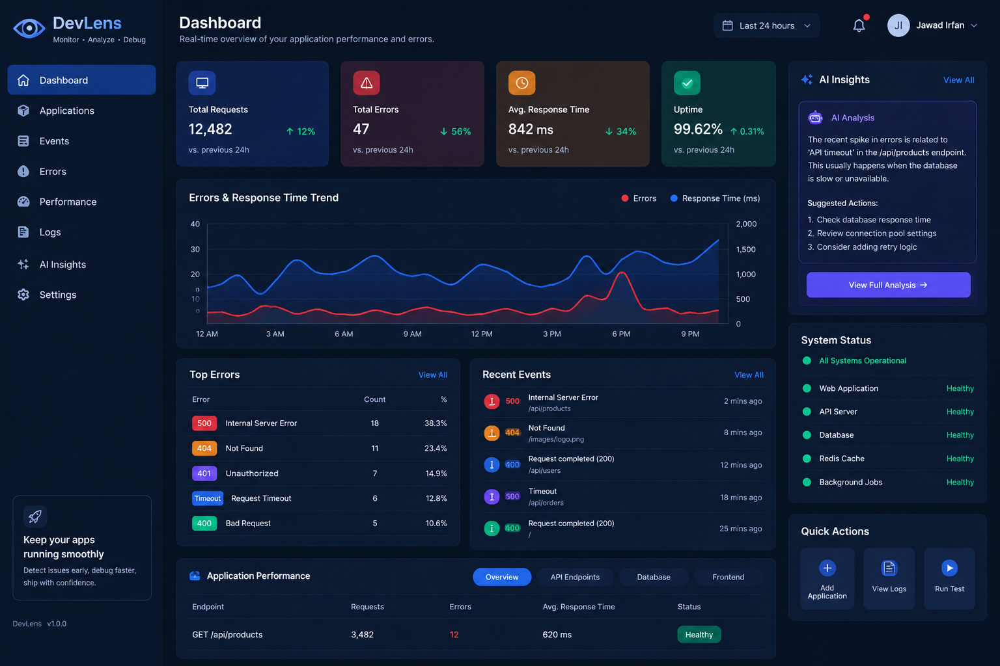

# DevLens — Intelligent Application Monitoring & Debugging Platform

**Final Year Project — CIT-362**

DevLens is a web-based application monitoring and debugging platform designed to help developers detect, analyze, and understand application errors and performance issues through a centralized dashboard.

## About the Project

Debugging an application can be difficult when errors, failed API requests, and performance issues are scattered across different places.

DevLens aims to simplify this process by collecting important application events and presenting them in an understandable dashboard.

Its goal is to help developers understand:

- What happened?
- Where did the issue occur?
- When did it happen?
- What could be the possible cause?
- How can the issue be resolved?

## Dashboard Preview



## Key Features

The planned platform features include:

- **Application Monitoring:** Monitor connected applications while they are running.
- **Error Tracking:** Collect and display application errors.
- **API Monitoring:** Track failed API requests and response information.
- **Performance Monitoring:** Analyze application response times.
- **Centralized Dashboard:** View monitoring events in one place.
- **AI-Assisted Analysis:** Explain technical errors in simple language and suggest possible debugging steps.

*Features will be implemented progressively during project development.*

## Technology Stack

| Area | Technologies |
|---|---|
| Frontend | React.js, JavaScript, HTML5, CSS3 |
| Development Tool | Vite |
| Backend (Planned) | Node.js, Express.js |
| Database (Planned) | MongoDB |
| AI Analysis (Planned) | AI-assisted error analysis |

## Project Objectives

1. Make application debugging easier.
2. Provide a centralized monitoring interface.
3. Help developers identify application issues.
4. Reduce the time required to understand errors.
5. Present technical information in a clear and understandable way.

## Getting Started

### Prerequisites

- Node.js
- npm
- Git

### Installation

Clone the repository:

```bash
git clone https://github.com/jawad-irfan/DevLens.git
```

Open the project directory:

```bash
cd DevLens
```

Install dependencies:

```bash
npm install
```

Start the development server:

```bash
npm run dev
```

Open the local URL displayed in your terminal.

## Project Structure

```text
DevLens/
├── public/
├── src/
│   ├── assets/
│   ├── App.jsx
│   ├── App.css
│   ├── index.css
│   └── main.jsx
├── index.html
├── package.json
├── package-lock.json
└── vite.config.js
```

## Project Information

- **Project Name:** DevLens
- **Project Code:** CIT-362
- **Project Type:** Final Year Project
- **Platform:** Web Application
- **Development Status:** In Progress

## Project Repository

[GitHub — jawad-irfan/DevLens](https://github.com/jawad-irfan/DevLens)

---

**DevLens — Making Application Debugging Easier to Understand.**